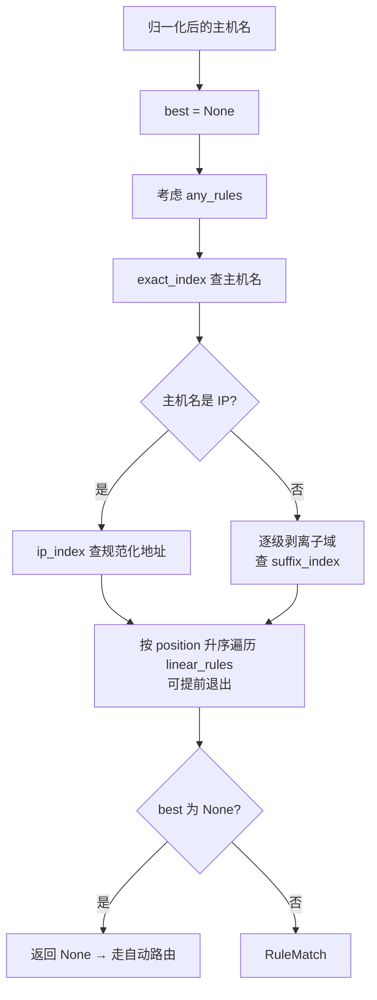
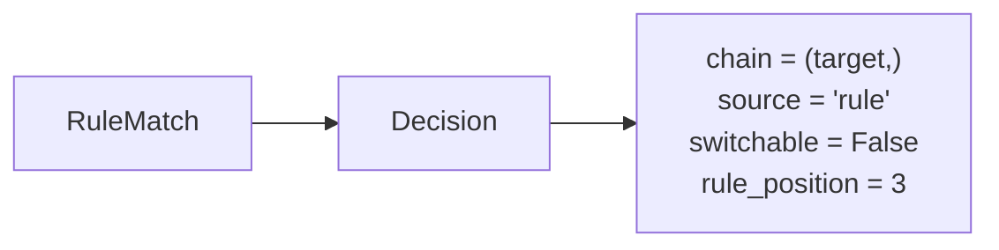
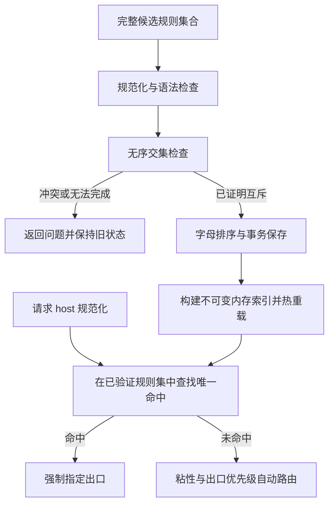

# DD_RULES.md - 规则引擎详细设计

| 版本 | 日期 | 变更说明 | 作者 |
| :--- | :--- | :--- | :--- |
| v3.1.0 | 2026-10-24 | 用户确认纯数字IPv4前缀通配符仅匹配IPv4；新增§13类型、交集约束及上线前复核，取代先前待确认状态 | Agent |
| v3.0.1 | 2026-10-24 | 互斥规则核心落地：有界星号交集、规范host状态、严格加载/保存、取消位置决胜；补§12具体预算、测量、历史盘点和未部署边界 | Agent |
| v3.0.0 | 2026-10-24 | 新增 §11 互斥规则目标设计：任意交叠均阻断（含相同出口）、保留星号通配符并停止新增正则、自动机交集检查、取消 position 优先级、字母排序、历史迁移及资源上限 | Agent |
| v1.0.0 | 2026-08-13 | 初始版本：规则解析与编译、last-match-wins 匹配、IP 字面量规范化、CONNECT 场景差异 | Agent |
| v2.0.0 | 2026-08-15 | **规则系统重构**：数据源由文本文件改为 `rules.db`，行式解析器整体删除、只保留条件识别；匹配语义改为 **first-match-wins** 并新增线性桶提前退出；匹配对象收窄为**仅主机名**（正则不再对 URL 求值）；新增 `WILDCARD` 类型；`Rule.index/origin_file/origin_line` 三字段合并为 `position`；新增条件端口检测与遮蔽告警 | Agent |
| v2.0.1 | 2026-08-16 | M5 实现回写：§6.1 的 `load_rules` 改为接 `RulesSource` 协议而非 `sqlite3.Connection`，编译拆出纯函数 `compile_rules` 供 Web 保存前校验共用（避免两份编译逻辑分叉） | Agent |
| v2.1.0 | 2026-10-24 | §6.3.1 补充保存入口的确定性遮蔽阻断：重复与完全遮蔽拒绝写入，部分重叠允许；历史规则运行时仍可加载；不可判定的正则/通配符交叠不作完整性承诺 | Agent |

**对应需求**：[RULES_CONFIG.md](../requirements/RULES_CONFIG.md) 全文、[PRD §4.5](../requirements/PRD_OVERVIEW.md)

> **已实现，生产尚待迁移**：§11 是用户确认的下一阶段规则设计。本文 §1–§10 保留当前/历史实现依据，其中 first-match-wins、正则准入、部分交叠允许、按 position 决胜的内容在实施 §11 后过时。不能仅按字母重排当前有序规则库来模拟无优先级匹配。需求以 [RULES_CONFIG §11](../requirements/RULES_CONFIG.md#11-互斥规则与无优先级匹配目标需求) 为准。

**上游依赖**：`config`（`rules.enabled`、`database.rules_path`）、`storage`（`RulesSource` 协议的实现 `RulesStore`）
**下游使用者**：`decision.router`、`web`（规则表格编辑与路由测试）

---

## 1. 设计目标与约束

| 目标 | 约束来源 |
|------|----------|
| 匹配是**纯函数**，无 I/O、无状态 | [ARCH §3.1](./ARCH_OVERVIEW.md) 决策层禁止 I/O |
| 匹配结果确定：**取 `position` 最小的匹配项** | [RULES §4.2](../requirements/RULES_CONFIG.md) |
| 匹配对象**仅主机名**，不涉及 URL、端口、路径 | [RULES §1.2](../requirements/RULES_CONFIG.md) |
| 规则命中即终止决策，不参与优先级链与粘性 | [PRD §3.1](../requirements/PRD_OVERVIEW.md) |
| IPv6 字面量的书写形式差异不影响匹配 | [RULES §3.5](../requirements/RULES_CONFIG.md) |
| 条件编译失败必须定位到规则序号 | [RULES §6.1](../requirements/RULES_CONFIG.md) |
| 每请求匹配开销 P99 < 1ms（与其他决策合计） | [PRD §7.1](../requirements/PRD_OVERVIEW.md) |
| 热路径不读库、不读文件 | [PRD §4.4.4](../requirements/PRD_OVERVIEW.md) |

### 1.1 v2.0.0 的三处语义变更

| 变更 | v1 | v2 | 理由 |
|------|----|----|------|
| 顺序语义 | last match wins，不短路 | **first match wins**，短路 | 「上面的规则更重要」是用户面对有序表格的默认预期；last match wins 还带来「宽规则必须写在前」这条反直觉约束 |
| 匹配对象 | URL（HTTP）或 `host:port`（CONNECT） | **主机名** | URL 正则对 CONNECT 静默失效，等于对所有 HTTPS 站点无效（[RULES §1.2](../requirements/RULES_CONFIG.md)） |
| 数据源 | 多个文本文件按序加载 | 单一 `rules.db` 有序表 | 界面成为唯一编辑入口，行式文本解析不再需要 |

---

## 2. 模块边界


`condition.classify` 被两条路径共用：加载时编译，以及 Web 保存前校验。共用一份实现保证「界面校验通过」与「启动能加载」口径一致，否则会出现「存得下、起不来」。

v1 的 `rules/parser.py` 承担行式文件解析（动作行、模式行、注释、行号），这部分**整体删除**。留下的条件识别逻辑迁入 `rules/condition.py`。

---

## 3. 数据契约

```python
# r_proxy/rules/model.py
from __future__ import annotations
from dataclasses import dataclass
from enum import Enum, auto
from ipaddress import IPv4Address, IPv6Address
import re


class PatternKind(Enum):
    ANY = auto()           # *
    DOMAIN_SUFFIX = auto() # *.example.com —— 含 apex
    WILDCARD = auto()      # 192.168.* —— * 在任意位置
    EXACT_HOST = auto()    # api.github.com
    IP_LITERAL = auto()    # 192.168.1.10 / [2001:db8::1]
    REGEX = auto()         # ^cdn\d+\. 或 /.../


@dataclass(frozen=True, slots=True)
class Rule:
    """一条已编译的规则。position 决定优先级——数值小者胜。"""
    position: int                    # 0 基，界面行序，库内唯一有序键
    kind: PatternKind
    raw: str                         # 原始条件文本，用于展示与调试
    target: str                      # 出口名
    # 按 kind 使用其中之一
    suffix: str | None = None        # DOMAIN_SUFFIX：不含 `*.` 的小写域名
    exact: str | None = None         # EXACT_HOST：小写主机名
    address: IPv4Address | IPv6Address | None = None
    regex: re.Pattern[str] | None = None   # REGEX 与 WILDCARD 共用，见 §4.3

    @property
    def location(self) -> str:
        """`rules[3]` 形式，用于校验报告与日志。"""
        return f"rules[{self.position}]"
```

### 3.1 为什么 `index` / `origin_file` / `origin_line` 合并成 `position`

v1 用 `index` 表达跨文件连续递增的全局序号，另用 `origin_file` + `origin_line` 表达位置以便报错。规则进库后这三者退化成同一个东西：库里就是一张有序表，行序既是优先级也是位置。

`position` 直接对应 `rule` 表的 `position` 列与界面上的行号，报错位置 `rules[3]` 与前端数组下标一一对应，前端据此高亮那一行，不需要任何换算。

### 3.2 RuleSet

```python
@dataclass(frozen=True, slots=True)
class RuleSet:
    """编译后的规则集，不可变。热重载时整体替换引用。"""
    rules: tuple[Rule, ...]                  # 按 position 升序
    any_rules: tuple[Rule, ...]
    exact_index: Mapping[str, tuple[Rule, ...]]
    suffix_index: Mapping[str, tuple[Rule, ...]]
    ip_index: Mapping[IPv4Address | IPv6Address, tuple[Rule, ...]]
    linear_rules: tuple[Rule, ...]           # WILDCARD + REGEX，按 position 升序

    @property
    def is_empty(self) -> bool:
        return not self.rules
```

不可变 + 整体替换的理由与 `ConfigSnapshot` 相同：飞行中的请求持有旧规则集直到结束，单个请求看到的路由意图始终自洽。

`WILDCARD` 与 `REGEX` 合并进同一个 `linear_rules` 桶：两者都无法用哈希索引，都需要逐条求值，且求值方式统一为 `pattern.search()`（§4.3）。合并成一个按 `position` 升序的桶，才能实现 §5.3 的提前退出。

---

## 4. 条件编译

### 4.1 识别顺序

顺序有讲究，判定必须互斥且无歧义：

```python
# r_proxy/rules/condition.py

_PORT_SUFFIX   = re.compile(r"\A(?:\[.*\]|[^:\[\]]+):\d{1,5}\Z")
_APEX_WILDCARD = re.compile(r"\A\*\.([^*]+)\Z")

def classify(text: str) -> Pattern:
    if not text:
        raise ConditionError("条件不能为空")

    # 1. 全匹配
    if text == "*":
        return Pattern(PatternKind.ANY)

    # 2. 正则优先：^ 与 / 都不是合法的主机名字符
    if text.startswith("^"):
        return Pattern(PatternKind.REGEX, regex=_compile_regex(text))
    if len(text) >= 2 and text.startswith("/") and text.endswith("/"):
        return Pattern(PatternKind.REGEX, regex=_compile_regex(text[1:-1]))

    # 3. 方括号包裹：意图明示为 IPv6，解析失败即报错，不退化为域名
    if text.startswith("[") and text.endswith("]"):
        return Pattern(PatternKind.IP_LITERAL, address=_address(text[1:-1], bracketed=True))

    # 4. 裸 IP 字面量。必须早于端口检测：2001:db8::1 含冒号但不是「带端口」
    if (addr := _try_address(text)) is not None:
        return Pattern(PatternKind.IP_LITERAL, address=addr)

    # 5. 含 * 的两种形态。必须早于端口检测：2001:db8:* 含冒号但意图是通配符
    if (m := _APEX_WILDCARD.match(text)) is not None:
        return Pattern(PatternKind.DOMAIN_SUFFIX, suffix=m.group(1).lower())
    if "*" in text:
        return Pattern(PatternKind.WILDCARD, regex=_compile_wildcard(text))

    # 6. 到这里仍含冒号的，只有两种可能，都是错误
    if _PORT_SUFFIX.match(text):
        raise ConditionError("条件只匹配主机名，不能带端口")
    if ":" in text:
        raise ConditionError("不是合法的 IP 地址；IPv6 请用方括号包裹")

    return Pattern(PatternKind.EXACT_HOST, exact=text.lower())
```

关键判定点：

| 输入 | 判定 | 说明 |
|------|------|------|
| `*` | ANY | — |
| `*.google.com` | DOMAIN_SUFFIX | `*.` 开头且其余无 `*`，含 apex |
| `*.example.*` | WILDCARD | 其余部分还有 `*`，不满足 apex 特例形状 |
| `192.168.*` | WILDCARD | 网段匹配的正常写法 |
| `2001:db8:*` | WILDCARD | 含冒号，但 `*` 检测在端口检测之前 |
| `192.168.1.10` | IP_LITERAL | `ip_address()` 解析成功 |
| `[2001:db8::1]` | IP_LITERAL | 剥括号后解析 |
| `2001:db8::1` | IP_LITERAL | 裸 IPv6 也接受（规则里不存在端口分隔歧义），但界面产出带括号形式 |
| `[2001:db8::zz]` | **ConditionError** | 方括号明示了意图是 IPv6，解析失败即报错 |
| `example.com:8443` | **ConditionError** | 条件不接受端口 |
| `[2001:db8::1]:443` | **ConditionError** | 同上，`_PORT_SUFFIX` 覆盖带括号形式 |
| `fe80::1%eth0` | **ConditionError** | zone id 不支持 |
| `^cdn\d+\.` | REGEX | — |
| `api.github.com` | EXACT_HOST | 前面全部落空 |

### 4.2 两处「必须早于端口检测」

这是本节最容易改错的地方。端口检测的动机是拦住 `example.com:8443` 这类静默失效的写法（[RULES §3.6](../requirements/RULES_CONFIG.md)），但冒号在 IPv6 里是合法字符，因此顺序不能颠倒：

| 若端口检测提前 | 后果 |
|----------------|------|
| 早于第 4 步 | `2001:db8::1` 被判为「带端口」而报错，合法的 IPv6 条件无法保存 |
| 早于第 5 步 | `2001:db8:*` 与 `fd00:*` 被判为「带端口」而报错，IPv6 前缀通配无法保存 |

第 6 步的两个分支互补：`_PORT_SUFFIX` 命中说明形状确实是 `host:port`，给出端口相关的提示；否则是形如 `2001:db8::zz` 的坏 IPv6，提示加方括号——加了括号后第 3 步会给出更精确的「方括号内不是合法 IPv6」。

**方括号内解析失败必须报错而非退化。** 若退化为 EXACT_HOST，用户写错的 IPv6 地址会变成一条永不匹配的域名规则，静默失效且极难发现。

> 请求侧的 CONNECT 目标要求更严格：无方括号的 IPv6 直接返回 `400`（见 [DD_PROXY.md](./DD_PROXY.md) §3.3）。规则条件中允许裸写是因为不存在端口分隔歧义——条件本身就不接受端口。

### 4.3 通配符的编译

```python
def _compile_wildcard(text: str) -> re.Pattern[str]:
    """`*` 展开为 `.*`，其余字符全部按字面转义，首尾锚定。

    锚定放进模式而不是靠调用方改用 fullmatch：WILDCARD 与 REGEX 共用
    `linear_rules` 桶，匹配时统一调 `search()`，桶内不需要按 kind 分支。
    """
    body = "".join(".*" if ch == "*" else re.escape(ch) for ch in text.lower())
    return re.compile(rf"\A{body}\Z")
```

三个决定：

| 决定 | 理由 |
|------|------|
| 只支持 `*`，不支持 `?` 与 `[abc]` | 用户预期来自 SwitchyOmega 与 shell 直觉里的 `*`；引入更多元字符会让 `.` 之类字符是否需要转义变得难以解释 |
| 逐字符 `re.escape` 而非 `fnmatch.translate` | `fnmatch` 把 `?` 与 `[seq]` 也当元字符，且其 `*` 的实现细节随版本变动；自己转译才能保证「除 `*` 外一律字面」这条可写进文档的承诺 |
| 模式内锚定 `\A...\Z` | 见上方 docstring：让线性桶的求值方式统一 |

`*` 展开为 `.*` 而非 `[^.]*`：`192.168.*` 必须能匹配 `192.168.1.10`，星号要能跨越点号。

### 4.4 错误报告

```python
@dataclass(frozen=True, slots=True)
class ConditionError(Exception):
    message: str
```

编译错误由调用方补上位置信息，转成统一的 `ValidationIssue`：

| 调用方 | `location` |
|--------|-----------|
| Web 保存校验 | `rules[3]`（提交列表的下标） |
| 启动 / 热重载加载 | `rules[3]`（库内 `position`） |

两者格式一致，因此界面上「保存时报的错」与「重载后报的错」指向同一行，用户不需要换算。

编译在遇到第一个错误时**不立即抛出**，而是收集全部错误后一次返回，与配置校验一致——用户希望一次看到所有问题，界面据此高亮多行。

### 4.5 正则的安全约束

条件由用户提供，正则存在灾难性回溯（ReDoS）风险。

| 措施 | 说明 |
|------|------|
| 编译期检查 | 嵌套量词模式（如 `(a+)+`）的启发式检测，仅告警不阻断 |
| 长度上限 | 单条正则 ≤ 1000 字符，超出报错 |
| 匹配输入上限 | Python `re` 不支持超时，改为限制输入长度：主机名超过 `MAX_SUBJECT` 时跳过线性桶并记 `WARNING` |

**v2 中输入上限的实际意义已大幅下降。** v1 的匹配输入是完整 URL，长度无上界，8192 字节的上限是真实防线。v2 只匹配主机名，而主机名在协议层已受限（DNS 上限 253 字节，且请求行长度另有上限，见 [DD_PROXY.md](./DD_PROXY.md) §3.1），线性桶的输入天然是短串。上限保留为廉价的兜底，正常流量不会触及。

嵌套量词检测保留为告警而非阻断：判定不可能精确，误杀合法正则的代价比放过一条可疑正则更大。

---

## 5. 匹配

### 5.1 匹配对象

| 请求类型 | 匹配对象 |
|----------|----------|
| 普通 HTTP | 主机名 |
| CONNECT | 主机名 |

**两者相同**，这是 v2 的核心简化。v1 的差异（HTTP 用完整 URL、CONNECT 用 `host:port`）导致同一条正则规则对 HTTP 生效、对 HTTPS 静默失效，是一个纯粹的陷阱。

所有 `PatternKind` 对两类请求的行为完全一致，不再需要 v1 那张「适用性」对照表。

### 5.2 分桶索引

规则数量通常在几十到几百条。精确类模式走哈希查表，只有通配符与正则需要逐条求值：



```python
# r_proxy/rules/matcher.py

def match(rule_set: RuleSet, target: RequestTarget) -> RuleMatch | None:
    if rule_set.is_empty:
        return None

    host = target.host                       # 已由 protocol 层归一化
    best: Rule | None = None

    def consider(rules: Iterable[Rule]) -> None:
        nonlocal best
        for r in rules:
            if best is None or r.position < best.position:
                best = r

    consider(rule_set.any_rules)
    consider(rule_set.exact_index.get(host, ()))

    if (addr := parse_ip(host)) is not None:
        # host 是 IP 时不进入后缀匹配：否则 `*.1.10` 会匹配 192.168.1.10
        consider(rule_set.ip_index.get(addr, ()))
    else:
        for suffix in _suffix_candidates(host):
            consider(rule_set.suffix_index.get(suffix, ()))

    best = _consider_linear(rule_set, host, best)
    return RuleMatch(rule=best, target=best.target) if best is not None else None
```

与 v1 的唯一差别是比较方向：`r.position < best.position` 取最小，v1 是 `r.index > best.index` 取最大。分桶结构本身不变——首匹配胜出并**不要求**按顺序遍历全部规则，只要求在所有命中项里取 `position` 最小的那条。

### 5.3 线性桶的提前退出

`linear_rules` 按 `position` 升序排列，因此一旦已有候选的 `position` 小于当前规则的 `position`，后面的规则即使命中也不可能更优：

```python
def _consider_linear(rule_set: RuleSet, host: str, best: Rule | None) -> Rule | None:
    if not rule_set.linear_rules or len(host) > MAX_SUBJECT:
        if len(host) > MAX_SUBJECT:
            logger.warning("主机名过长，跳过通配符与正则规则: %d 字节", len(host))
        return best
    for rule in rule_set.linear_rules:
        if best is not None and rule.position > best.position:
            break                      # 后面的都更靠后，不可能更优
        if rule.regex is not None and rule.regex.search(host):
            best = rule
    return best
```

这是 first-match-wins 带来的一项实际收益：last-match-wins 下必须求值**全部**正则才能确定最靠后的命中项，无法提前退出。当哈希桶已经命中一条靠前的规则时，线性桶往往一条都不需要求值。

### 5.4 后缀匹配不会误伤

| host | 规则 `*.example.com` | 结果 | 原因 |
|------|----------------------|------|------|
| `example.com` | 候选含 `example.com` | **匹配** | 域名及子域包含 apex |
| `www.example.com` | 候选含 `example.com` | **匹配** | — |
| `api.v2.example.com` | 候选含 `example.com` | **匹配** | — |
| `notexample.com` | 候选为 `notexample.com`、`com` | **不匹配** | 按点分段，`notexample.com` ≠ `example.com` |
| `fakeexample.com` | 同上 | **不匹配** | — |

```python
def _suffix_candidates(host: str) -> Iterator[str]:
    """www.api.example.com → www.api.example.com, api.example.com, example.com, com"""
    parts = host.split(".")
    for i in range(len(parts)):
        yield ".".join(parts[i:])
```

产出的第一项是 host 自身，这使 `*.example.com` 能匹配 `example.com`，即 [RULES §3.1](../requirements/RULES_CONFIG.md) 的 apex 特例。

按点分段是关键。若用字符串 `endswith(".example.com")` 判断，`notexample.com` 同样不匹配（因为缺少那个点），但分段法从结构上排除了这类歧义，不依赖对边界字符的正确处理。

### 5.5 IP 规范化

```python
def parse_ip(text: str) -> IPv4Address | IPv6Address | None:
    """规则侧与请求侧共用：两边对「什么算 IP」的判断必须一致，
    否则会出现「规则按域名编译、请求按 IP 匹配」这类永不命中的组合。"""
    try:
        return ip_address(text)
    except ValueError:
        return None
```

`ipaddress` 对象的相等性基于地址的整数值，因此：

| 写法 A | 写法 B | 相等 |
|--------|--------|------|
| `2001:db8::1` | `2001:0db8:0000:0000:0000:0000:0000:0001` | 是 |
| `2001:DB8::1` | `2001:db8::1` | 是 |
| `::ffff:192.168.1.1` | `192.168.1.1` | **否** |

最后一行需要注意：IPv4-mapped IPv6 地址与对应的 IPv4 地址在 `ipaddress` 中是不同对象。但由于**入向仅 IPv4**（[PRD §4.2.4](../requirements/PRD_OVERVIEW.md)），且出向的目标地址来自客户端请求的字面书写，实践中不会出现两种写法混用同一目标的情况。不做额外归一化。

**不支持** zone id（`fe80::1%eth0`）：`ip_address()` 对含 `%` 的输入抛 `ValueError`，若就此落入 EXACT_HOST 分支，会静默产生一条永不匹配的规则。因此编译阶段显式检测 `%` 并报错。

### 5.6 host 归一化的归属

匹配器**假设 `target.host` 已归一化**，归一化由 `protocol` 层在解析请求时完成：

| 处理 | 说明 |
|------|------|
| 转小写 | 域名大小写不敏感 |
| 去除方括号 | `[2001:db8::1]` → `2001:db8::1` |
| 去除末尾点 | `example.com.` → `example.com`（FQDN 绝对写法） |
| 去除端口 | host 与 port 分离存放 |

放在 `protocol` 层而非匹配器内的理由：归一化结果同时被规则匹配、粘性映射键、负面记忆键、日志记录使用。在入口处做一次，保证四者用的是同一个 host 字符串——若各自归一化，很容易出现「规则匹配用小写而粘性键用原始大小写」这类不一致。

条件侧对应地在编译时转小写（`exact`、`suffix`、通配符模式），两侧口径因此一致。

---

## 6. 加载

### 6.1 从 rules.db 读取

```python
# r_proxy/rules/loader.py

class RulesSource(Protocol):
    """规则行 (position, condition, upstream) 的来源。"""
    def read_rules(self) -> tuple[RuleRow, ...]: ...


def load_rules(source: RulesSource, *, enabled: bool) -> LoadResult:
    if not enabled:
        logger.warning("规则已被全局禁用（rules.enabled = false），全部流量走自动路由")
        return LoadResult(rule_set=EMPTY_RULE_SET)
    return compile_rules(source.read_rules())


def compile_rules(rows: Sequence[RuleRow]) -> LoadResult:
    """纯函数：规则行 → 规则集 + 问题清单。"""
    rules: list[Rule] = []
    issues: list[ValidationIssue] = []
    for position, condition, upstream in rows:
        try:
            pattern = classify(condition)
        except ConditionError as exc:
            issues.append(ValidationIssue("error", E_CONDITION, str(exc), f"rules[{position}]"))
            continue
        rules.append(Rule(position=position, kind=pattern.kind, raw=condition,
                          target=upstream, **pattern.fields()))
    issues.extend(detect_shadowing(rules))
    return LoadResult(rule_set=RuleSet.build(rules), issues=issues)
```

**读库与编译分开**：`load_rules` 接一个 `RulesSource` 协议（实现是 `storage/rules_store.py` 的 `RulesStore`），SQL 与排序收在存储层；`compile_rules` 是纯函数，加载路径与 Web 的保存前校验共用同一份编译逻辑。若这里直接收 `sqlite3.Connection`，`rules` 包就得依赖 `storage`，而 Web 校验一份「还没入库的候选列表」时无连接可传，只能另写一份编译——两份编译逻辑迟早会在某个条件类型上分叉，症状是「界面校验通过、启动却报错」。

排序由存储层负责，用 `ORDER BY position, id` 而非只按 `position`：`position` 列**不加唯一约束**（[DD_STORAGE §3](./DD_STORAGE.md)），补上 `id` 作为决胜项保证顺序确定。正常写入路径下 `position` 本来就唯一，这只是防御外部手工改库造成的重复值。

`rules.enabled = false` 时**根本不查库**，直接返回空规则集。不是「查出来再丢掉」——那会在救场场景下白白依赖一个可能已经损坏的库。启动时的建库同样跳过（[DD_STORAGE §4.8.3](./DD_STORAGE.md)）。

### 6.2 编译失败的处理

| 时点 | 处理 | 理由 |
|------|------|------|
| 启动 | **拒绝启动**，报告全部问题 | 与配置校验一致。静默跳过坏行会让实际路由行为与用户意图不符，而用户无从察觉 |
| 热重载 | **保留旧 `RuleSet`**，记 `ERROR` + 界面横幅 | 代理必须继续工作；旧规则集是已知可用的状态 |

正常情况下这两种失败都不该发生：Web 保存路径用同一个 `classify` 做过校验，写不进去坏数据。会触发的只有手工改库或库损坏。

### 6.3 遮蔽检测

```python
def detect_shadowing(rules: Sequence[Rule]) -> list[ValidationIssue]:
    """首匹配胜出下，被前面更宽的条件覆盖的规则永不生效。"""
```

检测范围限于可判定的组合：

| 情形 | 判定 |
|------|------|
| `*` 之后还有规则 | 其后**全部**规则永不生效 |
| 完全重复的条件 | 后出现的那条永不生效 |
| `*.example.com` 在 `www.example.com`（或 `*.sub.example.com`）之前 | 后者永不生效 |
| 涉及 `WILDCARD` 或 `REGEX` 的包含关系 | **不检测** |

正则与通配符之间的包含关系在一般情况下不可判定（等价于正则语言包含问题，对回溯正则更是不可行）。宁可漏报也不误报：一条被误判为「永不生效」的告警会让用户删掉实际有用的规则。

全部为 `warning` 级别，不阻断保存（[RULES §6.2](../requirements/RULES_CONFIG.md)）。

> v1 的重复检测告警文案是「先出现的那条永远不会生效」，v2 顺序语义反转后必须改成「后出现的那条」。这是语义变更时最容易漏改的地方。

#### 6.3.1 保存时阻止确定性重复与完全遮蔽（2026-10-24 补充）

本节更新 §6.3 的写入处置；上文「全部为 warning」仅记录当前实现的历史行为，自本补充定案后不再是目标行为。`detect_shadowing` 仍负责从规则的编译语义中发现可判定问题，但保存校验必须把下列 issue 作为阻断错误：

| 编译结果 | 保存处置 | 判定依据 |
|----------|----------|----------|
| `dedup_key` 相同 | 阻断 | 匹配语义相同的重复条件，后出现项永不可达，出口相同与否不影响判定 |
| 前序 `ANY` (`*`) | 后续每条规则均阻断 | 后续规则的全部 host 已被前序捕获 |
| 前序 `DOMAIN_SUFFIX` 覆盖后续精确 host / 更窄后缀 | 阻断后续项 | 已有 suffix 逐级比较证明后续项没有独立匹配集合 |
| 窄规则在前、宽规则在后 | 允许 | 后续宽规则仍覆盖未命中窄规则的 host，属于有意的例外/兜底组合 |
| 正则或普通通配符的包含关系无法证明 | 不阻断，不将其宣称为已全面检测 | 正则语言包含一般不可判定；避免误报把有效规则拒绝掉 |

**保存路径与运行时加载路径须区分严重级别。** Web 保存和其他规则写入入口（包括 `insert_rule` 固化规则）对可确定的重复/遮蔽拒绝写库；`validate` 预检返回同样的阻断结果。已有数据库中的对应 issue 在启动/热重载时维持可诊断的告警，不使代理因历史规则自动停机。可在写入校验适配层提升 issue 级别，或使用显式的 validation mode；不要把加载模式中的历史 warning 全局升级为启动 error。

拒绝保存发生在备份、整表替换、热重载与成功审计之前；拒绝时 `rules.db` 内容及 `revision` 不变。API 的错误详情包含所有受影响行的执行位置，并指出对应的前序覆盖规则。应用到整表保存与 `insert_rule`，防止通过规则页之外的写入口插入必然失效的规则。

部分交叠不是错误判据：当后续规则仍有未被前序规则覆盖的匹配范围时，允许保存。硬阻断只针对本节列出的可判定组合；正则与通配符相关的未知关系维持“未知”，不等于已证明安全，也不因此拒绝保存。

### 6.4 出口存在性校验

条件编译只管语法，出口名是否存在必须对着**当前配置**判断，因此不在 `rules` 包内做，而在两处调用点做：

| 调用点 | 行为 |
|--------|------|
| 启动 / 热重载 | 出口名不存在 → 拒绝启动；出口 `enabled = false` → 告警（[RULES §4.4.1](../requirements/RULES_CONFIG.md)） |
| Web 保存 | 出口名不存在 → 拒绝保存并返回 `rules[i]` 定位 |

两处口径必须一致，否则会出现「界面存得下、重启起不来」。

---

## 7. 规则命中后的行为



| 行为 | 说明 |
|------|------|
| 候选链长度 | 恒为 1 |
| 是否读粘性 | **否** |
| 是否写粘性 | **否** |
| 失败时 | **不切换**，原样返回错误 |
| 目标出口被禁用 | 不发起连接，返回 `502`，日志含规则序号 |
| 目标为 `direct` 但纯 IPv6 且本机无能力 | 不发起连接，返回 `502`，原因 `ipv6_unavailable` + 规则序号 |

后两行是「规则命中但出口不可用」的两种情形，共同点是**不发起连接、给出可诊断的错误**。用户需要知道的是「规则配错了」，而不是「网络不可达」。详见 [DD_ROUTING.md](./DD_ROUTING.md) §2.1。

给客户端的 `502` 响应体只含通用描述与 `request_id`，**不回显**出口名、地址或规则内容（[PRD §4.3.9](../requirements/PRD_OVERVIEW.md)）。规则序号只进日志与 `request_log`。

---

## 8. 路由测试接口

`r-proxy route-test` 与 Web 的路由测试模块共用同一入口，保证 CLI 与界面结果一致：

```python
@dataclass(frozen=True, slots=True)
class RouteTestResult:
    url: str
    host: str
    matched_rule: RuleMatch | None
    decision_source: Literal["rule", "manual", "auto", "priority"]
    upstream: str
    candidate_chain: tuple[str, ...]
```

与真实路由走**同一个** `Router.build_chain()`，只是不执行请求。共用实现避免了「测试说走 A，实际走 B」这类最难排查的问题。

`matched_rule` 的对外形状由 `position` 与 `condition` 两个字段构成，替代 v1 的 `file` + `line` + `pattern`（见 [WEBUI_SPEC §3.4](../requirements/WEBUI_SPEC.md)）。

---

## 9. 性能考量

| 项目 | 估算 |
|------|------|
| ANY + EXACT + IP 查表 | O(1)，几次字典查找 |
| 后缀候选生成 | O(域名段数)，典型 3–4 段 |
| 线性桶（通配符 + 正则） | 最坏 O(线性规则数)，命中靠前规则时常为 0 次求值 |

线性桶是唯一的非常数项，但 v2 有两点比 v1 更有利：

1. **提前退出**（§5.3）：哈希桶命中靠前规则时，线性桶大多不需要求值
2. **输入变短**：匹配对象从完整 URL 变成主机名，单次 `search` 的成本与回溯风险都显著下降

缓解手段：

- 界面提示优先使用域名及子域、精确主机这两类（走哈希），正则仅在确实需要时使用
- 线性规则超过 50 条时界面提示
- **不做**正则合并优化（把多条合成一个大正则）：合并后无法定位命中的是哪一条，破坏「错误与命中定位到规则序号」这一需求

不做匹配结果缓存。host 级的复用由粘性映射承担，那才是正确的缓存层次；而规则匹配本身在 v2 已经是哈希查表为主。

---

## 10. 测试要点

| 场景 | 期望 | 对应验收 |
|------|------|----------|
| `*` 与 `*.github.com` 同时匹配 | 取 `position` 更小者 | [RULES §4.2](../requirements/RULES_CONFIG.md) |
| 顺序语义 | 首匹配胜出，非「取最靠后」 | 同上 |
| 线性桶提前退出 | 已有更靠前候选时不再求值后续正则 | §5.3 |
| `*.example.com` 对 `example.com` | 匹配 | [RULES §3.1](../requirements/RULES_CONFIG.md) |
| `*.example.com` 对 `notexample.com` | 不匹配 | 同上 |
| `*.example.*` 对 `example.com` | 不匹配（非 apex 特例形状） | 同上 |
| `192.168.*` 对 `192.168.1.10` | 匹配 | [RULES §3.2](../requirements/RULES_CONFIG.md) |
| `192.168.*` 对 `10.192.168.1` | 不匹配（首尾锚定） | 同上 |
| `api-*.corp` 对 `api.corp` | 不匹配 | 同上 |
| 通配符中的 `.` | 按字面匹配，不当正则元字符 | §4.3 |
| `2001:db8:*` 条件 | 编译为 WILDCARD，不报「带端口」 | §4.2 |
| `[2001:0db8::1]` 条件 vs `[2001:db8::1]` 目标 | 规范化后匹配 | ST-10 |
| `[2001:db8::zz]` 条件 | 报错，不退化为域名 | §4.2 |
| `fe80::1%eth0` 条件 | 报错（zone id 不支持） | [RULES §3.5](../requirements/RULES_CONFIG.md) |
| `example.com:8443` 条件 | 报错（不接受端口） | [RULES §3.6](../requirements/RULES_CONFIG.md) |
| `[2001:db8::1]:443` 条件 | 报错（不接受端口） | 同上 |
| `^https?://x\.com/` 条件 | 对任何主机名都不命中 | [RULES §7 Q1](../requirements/RULES_CONFIG.md) |
| CONNECT 与普通 HTTP 同一主机 | 命中同一条规则 | §5.1 |
| 出口名不存在 | 启动拒绝；保存拒绝，定位 `rules[i]` | §6.4 |
| 出口 `enabled = false` | 启动告警不阻断，命中时 `502` | [RULES §4.4.1](../requirements/RULES_CONFIG.md) |
| 多处条件错误 | 一次返回全部 | §4.4 |
| `*` 之后仍有规则 | 遮蔽告警，指出其后全部失效 | §6.3 |
| 重复条件 | 告警文案指向**后**出现的那条 | §6.3 |
| 正则参与的遮蔽 | 不告警（不可判定，宁漏勿误） | §6.3 |
| `rules.enabled = false` | 不查库，返回空规则集 | §6.1 |
| 库内 `position` 重复 | 按 `(position, id)` 稳定排序，不崩 | §6.1 |
| 启动时某行条件非法 | 拒绝启动并报告全部问题 | §6.2 |
| 热重载时某行条件非法 | 保留旧 `RuleSet`，代理继续工作 | §6.2 |
| 主机名超过 `MAX_SUBJECT` | 跳过线性桶并记 WARNING，哈希桶正常 | §4.5 |
| 规则命中 | `switchable=False`，`chain` 长度为 1 | ST-09 |

## 11. 互斥规则与无优先级匹配目标设计

### 11.1 决策与适用范围

本节替代旧的首匹配胜出及顺序相关遮蔽检查。原设计阶段标注代码待实现，现已落地，具体验证见§12；当前生产容器尚未切换。

核心不变量：对于任意经过协议层规范化、可进入路由决策的 host，启用的规则集最多有一条规则命中。任意两条规则匹配集合有交集即冲突，包括完全重复、包含关系和部分交叠，**不论出口相同还是不同，也不论输入排列顺序**。

| 已考虑方案 | 取舍与决定 |
|------|------|
| 保留 first-match-wins，只隐藏调序 | 仍依赖隐含顺序，不能满足无优先级要求，不采用 |
| 固定精确 host/更具体后缀优先 | 仍允许交叠并引入类型优先级，不采用 |
| 规则集合互斥，写入时拒绝所有交叠 | 用户采纳；运行时只需找唯一命中项 |

出口本身的 `upstreams[].priority` 仍用于规则未命中的自动路由；本节取消的是规则之间的优先级。规则命中后仍强制指定出口，失败不切换，不读写粘性映射。相关入口和页面设计见 [DD_WEB §10.7.1.2](./DD_WEB.md#10712-互斥规则页面与写入契约目标设计)。

### 11.2 支持的条件与规范化

新提交支持精确 host、IP 字面量、域名及子域、普通 `*` 通配符，以及单独的 `*`。不再接受 `^...` 或 `/.../` 正则条件，不把它们退化为普通字符串。保留原始输入用于错误定位，编译与冲突检查使用与请求 host 相同的规范化语义。

- 精确域名不区分大小写；尾部点、IP 压缩形式、IPv6 方括号遵循现有统一规范化约定。等价 IP 不能绕过重复检查。
- `*` 匹配零个或多个字符，可跨越 `.`；普通通配符整串匹配，不启用 `?`、字符类、正则转义或正则量词。连续星号可合并为一个星号。
- `*.example.com` 保留现有特例：匹配 `example.com` 及所有层级子域，不匹配 `notexample.com`；不得简单套用会漏掉主域的普通 glob 语义。
- 域名后缀规则不匹配 IP 字面量；普通通配符可以匹配规范化后的 IP 字符串，如 `192.168.*`、`2001:db8:*`。检查与运行时必须使用同一类型判定和 host 接受范围。
- 条件仍不接受端口、URL、路径。单独 `*` 可以作为唯一规则，并保留强制路由风险告警；与任何其他规则并存则阻止保存。
- 停止新增正则不等于停止 `*` 通配符；内部也不需要把星号模式交给用户可控的 Python 正则执行器。

### 11.3 冲突检查与通配符交集

采用纯函数分析器，输入为**完整候选规则集合**，输出为编译结果、冲突对及无法完成的检查。复用同一条件模型生成运行时匹配器和校验器，避免两者对 `*.domain`、IP、大小写或星号的语义分叉。

| 类型组合 | 检查方式 |
|------|------|
| 精确 host / IP 与同类型 | 规范化键比较 |
| 精确项与域名后缀 / 通配符 | 用相同运行时匹配语义判断该固定 host |
| 两条域名后缀 | 按域名标签边界判断相等或包含，不用裸字符串 endswith |
| 单独 `*` 与任意规则 | 直接判冲突 |
| 普通通配符彼此、普通通配符与域名后缀 | 有限自动机语言交集判空 |

星号模式转换为包含字面字符转移、星号任意字符自循环和空转移的有限自动机；后缀规则表示为“主域本身”与“带标签边界的任意子域”的并集。对一对模式的乘积状态图做工作队列遍历并维护 visited；只有存在**可进入实际路由的规范化 host**通向双方接受状态，才能给出冲突证据。

实现应把 host 接受约束纳入检查（例如与共享的 host 语言约束求交），同时保留域名后缀不匹配 IP 的分支。不能只求一个任意字符串交集样本，因该样本不是合法 host 就宣布无冲突。若某个分支尚不能完整建模，返回“校验未完成”并阻断，不得放行或伪称已确认冲突。

遍历保存前驱信息，以重建一个共同匹配 host。证据必须再通过生产匹配函数和请求规范化验证，确保提示可复现。禁止用若干随机 host、固定测试域名或简单前后缀相似度替代完整交集检查。

```text
analyze_pair(a, b, budget):
    if cheap_exact_check_can_decide(a, b): return result
    traverse_product_automaton(a, b, host_constraints, budget)
    accepting_state_found -> OVERLAP(example_host)
    reachable_states_exhausted -> DISJOINT
    budget_exhausted_or_unsupported -> INCOMPLETE(reason)
```

### 11.4 开销、资源上限与完整性

保留最多 5,000 条规则和单条件最多 1,000 字符的既有限制。使用精确键、后缀索引及可证明不相容的必需前后缀剪枝，避免对明显无关的规则运行自动机。不能因为出口相同跳过检查。

通配符两两检查最坏仍涉及二次方数量的规则对；单对乘积图还取决于模式长度与 host 约束状态数。必须对单对访问状态、整次分析累计工作量和错误返回条数分别设硬上限；这些值在实施阶段按代表性 5,000 条规则集合做测量后确定并记录，发布前不得保留无界默认值。工作队列、visited、证据前驱及返回列表均受限。

| 分析结果 | 行为 |
|------|------|
| 所有候选规则对均可证明互斥 | 校验通过 |
| 任意一对存在交集 | 报冲突并阻止保存 |
| 超出预算、取消或某分支不能完成 | 报 `E_RULE_CHECK_LIMIT` 或明确的未完成错误并阻止保存 |
| 冲突明细达到返回上限 | 标明结果已截断并阻止保存，不能显示“全部问题已列出” |

有界分析由异步 Web 编排经 `asyncio.to_thread(...)` 调用；算法自身按工作量主动退出，不能以协程超时后留下无界后台任务。请求热路径不做全表冲突检查，不做数据库 I/O。

### 11.5 所有写入入口与副作用边界

整表保存、校验预检、粘性固化、备份导入或其他未来写规则入口必须调用同一个分析器。只检查“新规则是否与相邻项冲突”不够，必须验证最终完整候选集合。全局禁用规则时也不能绕过新提交的互斥与语法校验。

继续使用配置写入锁与 `revision` 乐观并发保护：在锁内读取基线并验证 revision，形成候选集合，分析通过后才生成规则备份、事务替换、热重载与成功审计。事务内再次核对 revision。冲突、正则不支持或分析未完成时，库内容、revision、规则备份、运行时快照和成功审计均不得改变。

原 `insert_rule` 的“插表首”和重复专用优先级语义撤销；固化成功后加入集合并按规范顺序存放。固化失败不得清除原粘性绑定；成功后的粘性清扫沿用既有约定。

### 11.6 字母排序、存储与定位

后端规范化条件后以 `condition COLLATE NOCASE, condition COLLATE BINARY, id` 稳定升序读取。排序用于呈现和规范化存储，不表示优先级。当前 SQLite NOCASE 的字母折叠范围为 ASCII；前端草稿比较应采用相同 ASCII 折叠和字面次级比较，不使用受浏览器语言设置影响的 localeCompare。域名国际化转换不在本次范围内，沿用统一规范化入口。

第一阶段保留 `rule.position` 字段及 `RuleRow` 形状以缩小迁移范围，但仅作为规范排序快照的位置/兼容字段：成功保存时按字母序重新编号，运行时不可用 position 决胜。数据库物理行顺序无保证，必须显式 ORDER BY。无需后端分页 API，仍返回完整列表，前端每页最多 100 条。

预检和失败保存的 `rules[i]` 必须指向**本次提交数组**的索引，分析前不得先排序导致报错错行；通过后才规范排序落盘。GET 的数组、路由测试的匹配位置及当前页面定位均使用同一规范快照。`rules[n]` 只是当时快照的位置，不保证跨 revision 的永久身份；历史日志位置不得被解释为新快照中的同一行。本阶段不引入永久规则 ID，也不迁移历史日志。

### 11.7 无优先级的运行时匹配

只有分析通过的不可变 RuleSet 才能进入运行时。保留精确 host、IP、后缀索引；普通通配符可复用预编译有限自动机逐项判断。找到唯一匹配即可返回，不比较 position，也不引入“精确优先”“最长后缀优先”等备用决胜逻辑。规则集合的任意排列必须得到相同出口和匹配条件。



同一个 host 每次路由决策仍先匹配规则。§9 中“host 级的复用由粘性映射承担”不能解释为缓存规则结果；粘性不会跳过规则匹配。本阶段不新增匹配结果缓存。

### 11.8 历史规则迁移与故障行为

实施前先对规则库做只读盘点，列出全部历史正则和冲突/分析未完成的规则，保留原条件、出口、位置及备份。正则需由用户改写为支持的条件或删除；不自动转换、不静默停用或删除，也不把不支持的正则当普通 host。

旧版本在迁移期间继续按其原语义运行；只有完成清理、候选规则集通过全量互斥校验后，才切换新引擎。不得先按字母重排旧库再检查，这可能在旧版本上直接改变路由。

新版本开启规则时，启动加载同样要求通过新校验；若库中仍有正则或冲突，拒绝启用该无效规则集并报告具体问题，不以任意选择第一条或静默自动路由代替。无有效快照的冷启动按现有规则加载错误策略拒绝启动；可显式用 `rules.enabled=false` 启动 Web 修复。禁用时请求不加载/匹配规则，管理页仍可读取原始条件供修复，但任何新保存都必须通过新校验。

新版本热重载遇到无效候选时保留上一份已通过互斥校验的快照并报告失败。首次升级不能把旧 first-match-wins 快照当作已验证的新快照。字母顺序保存与实际路由行为切换须一起发布，旧版回滚前也须确认新库在其支持语法下有效。

### 11.9 验收与交付边界

- 相同/不同出口的重复、包含和部分交叠均阻断；规则数组倒序、随机排列不改变校验结论。
- 覆盖精确 host、主域与深层子域、点号边界、IPv4/IPv6 规范化、星号零字符/跨点/多星号、单独 `*`。
- `api-*.example.com` 与 `*-prod.example.com` 必须发现交集，并返回可复现的共同 host；无交集模式不得仅因外观相似误报。
- 新正则条件明确报不支持；未知、超预算或诊断截断不产生成功校验。
- 预检、整表保存、固化和启动加载遵守同一语义；失败时所有持久化副作用及运行时状态保持基线。
- 调换有效规则集合的顺序，对同一批 host 的出口及匹配条件完全相同；定位数字可随规范排序改变。
- 页面无任何规则调序入口，按字母展示、过滤和分页；排序刷新不打断逐键编辑，保存提交完整集合。

对应需求及页面验收见 [RULES_CONFIG §11](../requirements/RULES_CONFIG.md#11-互斥规则与无优先级匹配目标需求)、[WEBUI_SPEC §2.4.5](../requirements/WEBUI_SPEC.md#245-互斥规则与固定字母排序目标需求)；存储和路由接入见 [DD_STORAGE](./DD_STORAGE.md)、[DD_ROUTING](./DD_ROUTING.md)。本次仅更新设计，后续实现须同步旧的 first-match-wins 测试与数据迁移验证。
| `route_test` 与真实路由 | 结果一致（共用 `build_chain`） | §8 |

## 12. v3.0 实现回填与部署前置条件

本节更新 §11 的实施状态：代码已按互斥规则设计实现；生产容器尚未切换。此前“代码待实现”的描述保留作为设计阶段记录，以本节状态为准。

### 12.1 模块与算法

- `rules/glob.py` 提供仅星号为元字符的整串匹配器，并实现规范化 host 的有限状态约束。IPv6 状态跟踪组数、非前导零、最长零段压缩和左侧决胜，避免把不可解析或非规范 IPv6 当作共同证据；域名后缀排除 IP。
- `rules/overlap.py` 采用精确键/后缀索引和星号乘积自动机，保存前驱重建证据。每次候选字符尝试、状态访问和按条件长度计费的规则对检查计入预算；不会以抽样替代交集判空。
- `rules/condition.py` 拒绝正则与未完成的 `*.` / `**.` 后缀，避免尾点规范化意外变成全匹配；IPv6 方括号不能包 IPv4，域名后缀不能含冒号。`**.domain` 保持普通 glob 类型，不因内部合并连续星号而变成包含主域的后缀特例。
- `compile_rules()` 返回带可选 conflict 的严格问题清单；`ANALYSIS_VERSION=exclusive-v1` 供只读盘点确认分析器能力。`Rule.position` 仅定位快照，运行时不比较其优先级。
- `Application` 在校验和候选库准备均成功后才一并发布配置、规则集和规则库门面；无效重载不能把 Web 读写指向被拒绝的新库。

### 12.2 已确定的资源上限与测量

| 项目 | 实现值 |
|------|------|
| 完整规则集条数 | 5,000 |
| 原条件及规范化后条件长度 | 均不超过 1,000 字符 |
| 单对自动机 visited 状态 | 100,000 |
| 单次集合分析累计工作预算 | 2,000,000 |
| 返回诊断数量 | 200，截断时另返回明确阻断错误 |
| 普通星号运行时匹配输入 | 最多 8,192 字符，沿用既有限制 |

上述不是成功保证：超限必须阻止保存并说明未完成。Web 的 CPU 分析通过有界 `to_thread` 执行，无效候选不触发写入/备份/成功审计。

本机单次纯编译测量：5,000 条互不交叠精确域名约 95.78ms，5,000 条互不交叠域名后缀约 118.89ms；未包含数据库、Web 或持续并发开销，不作为请求吞吐保证。1,521 对短星号模式与 126 个短 host 的穷举结果一致；另覆盖全部 256 种 IPv6 零/非零组布局的规范化接受行为。

### 12.3 历史配置盘点与切换条件

新增 `python -m r_proxy.rules.audit --config /config/config.toml` 只读工具，可通过 `--data-dir` 显式映射容器数据目录；SQLite URI mode=ro、事务快照，不建库、不迁移、不启动代理。默认仅输出数量摘要；`--output` 独占创建 0600 的详细报告，避免覆盖配置或数据库。

本机生产快照 revision 445 共 388 条：365 条域名后缀，23 条纯数字 IPv4 前缀普通星号；无正则、未知出口或已禁用出口引用。对全部 75,078 对独立进行有界交集检查并经真实请求解析/匹配验证，得到 8,395 对交叠（同出口 5,728，不同出口 2,667），没有未完成对。标准保存分析器受累计工作预算及最多200条诊断双重限制；本次候选容器预检返回134条冲突后明确报告工作预算超限。离线完整盘点与单次保存预算是不同任务。

根因是现有普通星号也匹配域名，如 `10.0.96.*` 可以匹配 `10.0.96.example.com`。23 条数字前缀与 365 条域名后缀全部交叠，而各自组内无交叠。该结论不能通过“相同出口允许”绕过。

**当前不能直接把此库切换到严格引擎**。将数字前缀限定为 IP-only 是另一个语义决定，尚待用户确认；当前代码保持普通星号语义，不擅自收窄、不删改生产规则、不静默禁用规则。完整含 host 的迁移报告保存在本地忽略知识库中，不纳入公开文档或版本控制。

相关页面与数据契约见 [DD_WEB](./DD_WEB.md)、[DD_STORAGE](./DD_STORAGE.md)；迁移仍遵守 §11.8。

### 12.4 最终验证与候选容器

完整 pytest 在获准沙箱外执行：1437 passed、2条依赖弃用警告；Ruff与MyPy（66个源文件）通过。沙箱内的偶发测试等待已用最小程序定位为asyncio self-pipe发送EPERM，不能将其归因于生产逻辑。

候选镜像 `r-proxy:exclusive-candidate` 已构建，隔离网络下验证health、Web API、HTTP实际转发、CONNECT数据通路、同出口交叠/部分通配符交叠/正则拒绝，以及失败保存不改变规则和revision。79个运行文件汇总SHA-256与工作区一致：`572219fead8af9749f278db62028e5589b92d71295547493fb91930c97bab9c4`。

生产配置只读预检仍为revision445、388条，源快照摘要与离线盘点一致，`ready=false`。正式容器继续运行旧镜像且healthy；数字IPv4前缀是否限定IP-only仍待用户确认。候选验证成功不表示现有生产配置可直接部署。

## 13. 纯数字 IPv4 前缀通配符（用户已确认）

用户确认：纯数字 IPv4 前缀通配符只匹配 IP 地址。此前§12的待确认和交叠阻断描述保留为历史盘点结果，实施本节后重新检查生产配置，再按既有授权升级正式容器。

- 新增内部 `IPV4_WILDCARD` 类型；条件首字符为数字、含点和星号，全部字符仅为ASCII数字、点和星号时自动识别，不增加前端类型选择或改变API字段。
- `192.168.*`、`10.0.96.*` 仅匹配可解析为IPv4的规范地址，不匹配 `192.168.example.com`、非法IPv4或IPv4映射的IPv6。星号仍按整串模式匹配并可跨点；`192.168.1*`、`10.*.*` 同样受IPv4范围约束。
- 纯数字条件中完整固定的十进制段要求0～255且无前导零；连续点、超过三个字面点等不可能的IPv4形式明确拒绝。`*.1.10` 以星号开头，仍是域名后缀，不因含数字被当作IP前缀。普通含字母星号与IPv6星号沿用原类型。
- 运行时和交集分析共用IPv4约束。IPv4通配符与域名后缀的匹配集合天然不相交；与精确IPv4、其他IPv4通配符、普通通配符或单独 `*` 仍需检查交集，同出口也拒绝。
- 复用有限host状态中的IPv4段数/数值/位数判定，在乘积图中剔除非IPv4前缀并只接受四段合法地址，不用抽样证明无交集。资源预算沿用§12。
- 分析器标记升级为 `exclusive-v2`；只读盘点工具要求此标记，以免旧语义结果被误认为新配置已验证。
- 生产既有条件文本无需重写；通过只读预检后备份配置和规则库、保留旧镜像，再重建容器。验收必须包含数字前缀命中IPv4、不命中域名、同出口IP范围交叠拒绝、生产规则全量加载及真实HTTP/CONNECT数据通路。

相关需求：[RULES_CONFIG §11.7](../requirements/RULES_CONFIG.md#117-用户确认的ipv4前缀通配符语义)。

### 13.1 实现、历史配置复核与正式上线

本节用户决定已实现并部署。内部类型为 `IPV4_WILDCARD`，分析标记 `exclusive-v2`；运行时先解析IP并要求version=4，交集乘积图使用同一四段IPv4语言约束。与域名后缀无需产生冲突，与普通通配符/精确IP/其他IP通配符仍进行实际检查。

新增23个回归场景后完整pytest为1460 passed、2条既有依赖弃用警告，Ruff/MyPy通过。独立对照覆盖625个规范IPv4、96种模式、600对随机组合，未发现漏检，冲突证据均通过双方生产匹配器和IPv4规范验证。

历史生产快照revision445、388条在新语义下完整预检通过：23条IPv4通配符、365条域名后缀，冲突0。原8,395对交叠是先前普通字符串语义的真实结果，现在由用户明确批准的类型约束消除；未删除、改写或重排生产规则，原快照摘要保持 `79cfd3297052ecd75ee5a7f89c1648f2e7cc6620ccce0d89c0b3e8bfeb6856a2`。

正式容器已使用镜像 `sha256:f2cef6f8a591d5131d91c5e3cb438361dffad02e95d34ba1edb996faf54a9d22`，running/healthy。容器内79个运行文件与工作区汇总SHA一致：`a4edd5d4cdd5988ac2df31eb47a6258137ac8b2dcf0564811d260b9622aac945`。生产API鉴权、规则字母排序、真实配置IPv4/域名分别命中、同出口IP交叠预检、HTTP转发与CONNECT数据通路通过；规则revision及内容摘要在升级前后不变。

§12的“仍待用户确认/正式容器未切换”是此前阶段记录，以本节和 [DD_DEPLOY §15](./DD_DEPLOY.md#15-2026-10-24-ipv4专用通配符确认后的正式升级) 的上线状态为准。
