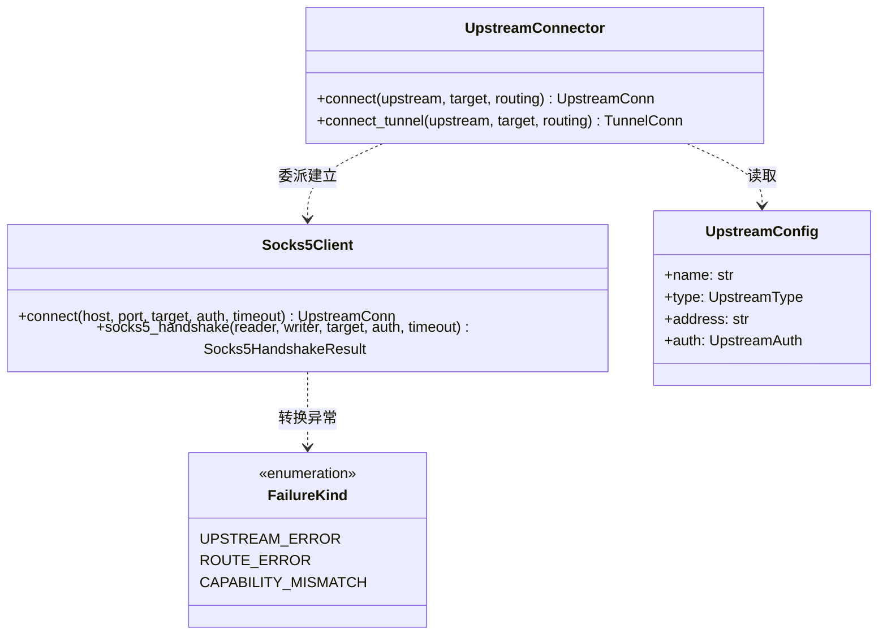
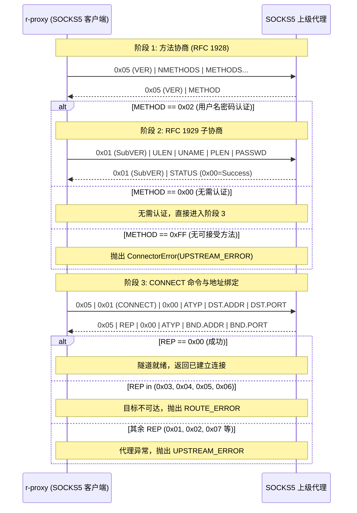
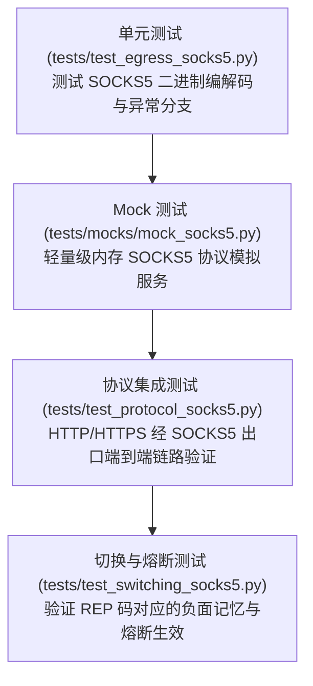

# DD_SOCKS5.md - SOCKS5 出口详细设计

| 版本 | 日期 | 变更说明 | 作者 |
| :--- | :--- | :--- | :--- |
| v1.0.0 | 2026-10-12 | 初始版本：SOCKS5 客户端二进制状态机、错误映射矩阵、协议层集成与测试策略 | Agent |

**对应需求**：[SOCKS5_UPSTREAM.md](../requirements/SOCKS5_UPSTREAM.md)、[PRD §4.2](../requirements/PRD_OVERVIEW.md)

**上游依赖**：`config`、`contracts`
**下游使用者**：`egress.connector`、`protocol.connection`、`web.probe`

---

## 1. 架构定位与模块边界

SOCKS5 客户端作为 `egress`（出口传输）层的一个轻量级子模块存在，专门负责处理与上级 SOCKS5 代理的二进制协商与隧道打通。



### 1.1 依赖与红线约束

1. **零第三方依赖**：纯使用 Python 3.12+ 标准库 `struct`、`asyncio`、`ipaddress` 实现。
2. **职责单一性**：SOCKS5 模块**只负责**将 TCP 连接建立到指定目标，并对阶段错误进行准确归类；一旦连接建立，后续的 HTTP 请求构造、双向数据流 Relay 均复用现有协议栈。
3. **内存权威与零阻塞**：所有 I/O 均依托非阻塞 `StreamReader/StreamWriter`，不引入任何同步锁或持久化开销。

---

## 2. SOCKS5 协议二进制交互与状态机

SOCKS5 协议交互分为三个严格阶段：方法协商、子认证（可选）、CONNECT 命令请求。



### 2.1 帧格式与字段定义

#### 2.1.1 客户端认证方法选择 (Client Greeting)

```text
+----+----------+----------+
|VER | NMETHODS | METHODS  |
+----+----------+----------+
| 1  |    1     | 1 to 255 |
+----+----------+----------+
```
- `VER`: 固定 `0x05`。
- 若出口未配置 `auth`：发送 `\x05\x01\x00`（支持无需认证）。
- 若出口配置了 `auth`：发送 `\x05\x02\x00\x02`（优先支持无需认证与用户名/密码认证）。

#### 2.1.2 服务端方法选择响应 (Server Choice)

```text
+----+--------+
|VER | METHOD |
+----+--------+
| 1  |   1    |
+----+--------+
```
- `VER` 必须为 `0x05`。
- `METHOD`:
  - `0x00`: 无需认证。
  - `0x02`: 用户名/密码认证。
  - `0xFF`: 无可接受的方法（抛出 `UPSTREAM_ERROR`）。

#### 2.1.3 RFC 1929 用户名密码认证

```text
+----+------+----------+------+----------+
|VER | ULEN |  UNAME   | PLEN |  PASSWD  |
+----+------+----------+------+----------+
| 1  |  1   | 1 to 255 |  1   | 1 to 255 |
+----+------+----------+------+----------+
```
- 服务端响应：
```text
+----+--------+
|VER | STATUS |
+----+--------+
| 1  |   1    |
+----+--------+
```
- `STATUS == 0x00` 表示认证成功，其余值表示认证失败（抛出 `UPSTREAM_ERROR`）。

#### 2.1.4 SOCKS5 CONNECT 请求报文

```text
+----+-----+-------+------+----------+----------+
|VER | CMD |  RSV  | ATYP | DST.ADDR | DST.PORT |
+----+-----+-------+------+----------+----------+
| 1  |  1  | X'00' |  1   | Variable |    2     |
+----+-----+-------+------+----------+----------+
```
- `VER`: `0x05`
- `CMD`: 固定 `0x01` (CONNECT)
- `RSV`: `0x00`
- `ATYP` 及 `DST.ADDR`：
  - **域名优先**（`ATYP = 0x03`）：当目标为域名时，第 1 字节为域名长度 $N$，随后跟随 $N$ 字节域名 ASCII 文本。让 SOCKS5 代理在服务端执行 DNS 解析，规避本地解析失败与污染。
  - **IPv4**（`ATYP = 0x01`）：4 字节网络序二进制地址（`ipaddress.IPv4Address.packed`）。
  - **IPv6**（`ATYP = 0x04`）：16 字节网络序二进制地址（`ipaddress.IPv6Address.packed`）。
- `DST.PORT`: 2 字节大端整数（`>H`）。

#### 2.1.5 SOCKS5 CONNECT 响应报文

```text
+----+-----+-------+------+----------+----------+
|VER | REP |  RSV  | ATYP | BND.ADDR | BND.PORT |
+----+-----+-------+------+----------+----------+
| 1  |  1  | X'00' |  1   | Variable |    2     |
+----+-----+-------+------+----------+----------+
```
- `REP`: 响应结果代码，决定连接是否成功及错误类型。
- `BND.ADDR` / `BND.PORT`: 由服务端绑定的出口 IP 与端口，客户端在收到后需按长度跳过，确保读流对齐。

---

## 3. 错误归类与状态转换矩阵

SOCKS5 交互阶段的所有异常都必须映射为标准的 `ConnectorError`，明确指派 `FailureKind`：

| 异常事件 / REP 代码 | 错误标识 (`ConnectorError.error`) | 映射类别 (`FailureKind`) | 设计依据 |
| :--- | :--- | :--- | :--- |
| **TCP 无法连接上级代理** | 系统 errno（如 `ECONNREFUSED`） | `UPSTREAM_ERROR` | 上级代理宕机或端口不可达，熔断计数累加 |
| **握手等待超时** | `TimeoutError` | `UPSTREAM_ERROR` | 上级代理内部挂起，熔断计数累加 |
| **协议不匹配（如返回 HTTP 文本）** | `BAD_SOCKS_VERSION` | `UPSTREAM_ERROR` | 对端不是合法的 SOCKS5 服务 |
| **方法不支持 (`METHOD=0xFF`)** | `NO_ACCEPTABLE_AUTH` | `UPSTREAM_ERROR` | 认证方式不匹配，累加熔断计数 |
| **RFC 1929 认证失败** | `AUTH_FAILED` | `UPSTREAM_ERROR` | 凭据错误，累加熔断计数 |
| **`REP = 0x01`** (General failure) | `SOCKS5_REP_01` | `UPSTREAM_ERROR` | 上级代理内部故障 |
| **`REP = 0x02`** (Not allowed by ruleset) | `SOCKS5_REP_02` | `UPSTREAM_ERROR` | 代理安全策略限制访问此目标 |
| **`REP = 0x03`** (Network unreachable) | `SOCKS5_REP_03` | `ROUTE_ERROR` | 目标网络不可达，只记录 `(host, upstream)` 负面记忆 |
| **`REP = 0x04`** (Host unreachable) | `SOCKS5_REP_04` | `ROUTE_ERROR` | 目标主机不可达，只记录目标负面记忆 |
| **`REP = 0x05`** (Connection refused) | `SOCKS5_REP_05` | `ROUTE_ERROR` | 目标端口未开放/拒绝连接，只记录目标负面记忆 |
| **`REP = 0x06`** (TTL expired) | `SOCKS5_REP_06` | `ROUTE_ERROR` | 路由跳数超限，只记录目标负面记忆 |
| **`REP = 0x07`** (Command not supported) | `SOCKS5_REP_07` | `UPSTREAM_ERROR` | 代理服务端实现不支持 CONNECT 命令 |
| **`REP = 0x08`** (Address type not supported) | `SOCKS5_REP_08` | `CAPABILITY_MISMATCH` | 代理不支持该地址类型，不熔断、不记负面记忆 |

---

## 4. 详细代码契约设计

### 4.1 独立模块 `r_proxy/egress/socks5.py`

```python
"""SOCKS5 客户端协议实现。

对应设计：docs/design/DD_SOCKS5.md。
遵循零第三方依赖红线，仅使用标准库 struct 与 asyncio。
"""

from __future__ import annotations

import asyncio
import ipaddress
import struct
from enum import IntEnum

from r_proxy.config.model import UpstreamAuth
from r_proxy.contracts import FailureKind, RequestTarget
from r_proxy.egress.connector import ConnectorError

class Socks5Reply(IntEnum):
    SUCCEEDED = 0x00
    GENERAL_FAILURE = 0x01
    RULE_FORBIDDEN = 0x02
    NETWORK_UNREACHABLE = 0x03
    HOST_UNREACHABLE = 0x04
    CONNECTION_REFUSED = 0x05
    TTL_EXPIRED = 0x06
    COMMAND_NOT_SUPPORTED = 0x07
    ADDRESS_TYPE_NOT_SUPPORTED = 0x08

async def socks5_handshake(
    reader: asyncio.StreamReader,
    writer: asyncio.StreamWriter,
    target: RequestTarget,
    auth: UpstreamAuth | None,
    timeout: float,
) -> None:
    """在已连通的 TCP 套接字上执行 SOCKS5 握手并连通目标。
    
    :raises ConnectorError: 握手或连通失败，携带规范归类的 FailureKind。
    """
    try:
        async with asyncio.timeout(timeout):
            await _negotiate_auth(reader, writer, auth)
            await _request_connect(reader, writer, target)
    except TimeoutError as exc:
        raise ConnectorError(FailureKind.UPSTREAM_ERROR, "Socks5HandshakeTimeout") from exc
    except OSError as exc:
        raise ConnectorError(FailureKind.UPSTREAM_ERROR, "Socks5IOError") from exc
```

### 4.2 目标地址打包实现 (`_build_connect_request`)

```python
def build_connect_request(target: RequestTarget) -> bytes:
    # 明确清洗方括号：防止 [2001:db8::1] 被 ip_address 抛错后误降级为域名 ATYP=0x03
    clean_host = target.host.strip("[]")
    port = target.port
    
    # 1. 尝试解析为 IPv4 / IPv6 字面量
    try:
        ip = ipaddress.ip_address(clean_host)
        if ip.version == 4:
            return struct.pack("!BBBB", 0x05, 0x01, 0x00, 0x01) + ip.packed + struct.pack("!H", port)
        else:
            return struct.pack("!BBBB", 0x05, 0x01, 0x00, 0x04) + ip.packed + struct.pack("!H", port)
    except ValueError:
        # 2. 域名：ATYP=0x03，1 字节长度 + ASCII
        encoded_host = clean_host.encode("ascii")
        if len(encoded_host) > 255:
            raise ConnectorError(FailureKind.CAPABILITY_MISMATCH, "DomainTooLong")
        return (
            struct.pack("!BBBB", 0x05, 0x01, 0x00, 0x03)
            + struct.pack("!B", len(encoded_host))
            + encoded_host
            + struct.pack("!H", port)
        )
```

### 4.3 两阶段应答解析与防吞错机制 (`_read_connect_reply`)

```python
async def read_connect_reply(reader: asyncio.StreamReader) -> None:
    # 阶段一：原子读取前 4 字节，第一时间捕获 REP 响应码
    head = await reader.readexactly(4)
    ver, rep, rsv, atyp = struct.unpack("!BBBB", head)
    if ver != 0x05:
        raise ConnectorError(FailureKind.UPSTREAM_ERROR, "BAD_SOCKS_VERSION")
    
    # 阶段二：读取服务端返回的 BND 绑定地址与端口，对齐传输流
    # 防吞错保护：部分非标代理在建连失败（如 rep=0x05）时会立即掐断连接（EOF）。
    # 若此时抛出 IncompleteReadError，绝不能覆盖已解析出的 rep 归类，否则会导致误熔断。
    try:
        if atyp == 0x01:    # IPv4
            await reader.readexactly(4 + 2)
        elif atyp == 0x03:  # Domain
            dlen = (await reader.readexactly(1))[0]
            await reader.readexactly(dlen + 2)
        elif atyp == 0x04:  # IPv6
            await reader.readexactly(16 + 2)
        else:
            if rep == Socks5Reply.SUCCEEDED:
                raise ConnectorError(FailureKind.UPSTREAM_ERROR, "BAD_ATYP_IN_REPLY")
    except (asyncio.IncompleteReadError, OSError):
        # 仅当响应本身已宣告失败时容忍流提前断开
        if rep == Socks5Reply.SUCCEEDED:
            raise ConnectorError(FailureKind.UPSTREAM_ERROR, "IncompleteReadInBindAddr")

    if rep != Socks5Reply.SUCCEEDED:
        kind = _classify_rep(rep)
        raise ConnectorError(kind, f"SOCKS5_REP_{rep:02x}")
```

---

## 5. 协议层集成设计

### 5.1 与 `UpstreamConnector` 的衔接

在 [`r_proxy/egress/connector.py`](file:///media/data/git/r_proxy/r_proxy/egress/connector.py) 中，`connect` 与 `connect_tunnel` 统一纳入 `socks5` 分支：

```python
class UpstreamConnector:
    async def connect(self, upstream: UpstreamConfig, target: RequestTarget, routing: RoutingConfig) -> UpstreamConn:
        timeout = upstream.connect_timeout or routing.connect_timeout
        if upstream.is_direct:
            return await self._open(target.host, target.port, timeout, routing, is_direct=True)
        
        host, port = self._upstream_endpoint(upstream)
        conn = await self._open(host, port, timeout, routing, is_direct=False)
        if upstream.type == "socks5":
            try:
                await socks5_handshake(conn.reader, conn.writer, target, upstream.auth, timeout)
            except BaseException:
                await conn.close()
                raise
        return conn

    async def connect_tunnel(self, upstream: UpstreamConfig, target: RequestTarget, routing: RoutingConfig) -> TunnelConn:
        timeout = upstream.connect_timeout or routing.connect_timeout
        if upstream.is_direct:
            conn = await self._open(target.host, target.port, timeout, routing, is_direct=True)
            return TunnelConn(conn=conn, status=200)

        host, port = self._upstream_endpoint(upstream)
        conn = await self._open(host, port, timeout, routing, is_direct=False)
        
        if upstream.type == "socks5":
            try:
                await socks5_handshake(conn.reader, conn.writer, target, upstream.auth, timeout)
            except BaseException:
                await conn.close()
                raise
            # SOCKS5 握手成功等价于隧道打通，status 人为置 200，复用上层控制流
            return TunnelConn(conn=conn, status=200)

        # 上级 HTTP 代理维持既有 HTTP CONNECT 握手逻辑
        try:
            status, headers = await self._handshake(conn, target, timeout)
        except BaseException:
            await conn.close()
            raise
        return TunnelConn(conn=conn, status=status, headers=headers)
```

### 5.2 请求构造器适配 (`build_request`)

在 [`r_proxy/protocol/connection.py`](file:///media/data/git/r_proxy/r_proxy/protocol/connection.py) 中，`build_request` 用于组装发往出口的 HTTP 请求报文：

```python
def build_request(target: RequestTarget, head: RawHead, upstream: UpstreamConfig) -> bytes:
    # 关键契约：direct 与 socks5 都连接到目标对端（L4 透明代理），必须发 origin-form
    # 只有上级 http 代理发 absolute-form
    if upstream.is_direct or upstream.type == "socks5":
        request_line = f"{head.method} {_path_qs(target, head)} HTTP/1.1"
    else:
        request_line = f"{head.method} {target.url} HTTP/1.1"

    headers = strip_hop_by_hop(head.headers)
    items = [(k, v) for k, v in headers.items() if k.lower() not in ("host", "connection")]
    items.insert(0, ("Host", _host_header(target)))
    items.append(("Connection", "close"))

    lines = [request_line, *(f"{k}: {v}" for k, v in items)]
    return ("\r\n".join(lines) + "\r\n\r\n").encode("latin-1")
```

---

## 6. Web 管理界面与探活机制集成

1. **类型定义与参数校验**：
   - [`r_proxy/web/schemas.py`](file:///media/data/git/r_proxy/r_proxy/web/schemas.py)：`UpstreamCreate.type` 和 `UpstreamItem.type` 允许 `"socks5"`。
   - `UpstreamAuth` 密码必须在 API 序列化时自动脱敏，不输出明文。
2. **主动连通性测试 (Probe)**：
   - [`r_proxy/web/probe.py`](file:///media/data/git/r_proxy/r_proxy/web/probe.py) 中执行 `connect_tunnel(upstream, probe_target(), routing)`。
   - 由于 `UpstreamConnector.connect_tunnel` 已无缝处理 SOCKS5 握手，探活逻辑**零额外修改**即可自动支持 SOCKS5 出口，并在探测失败时输出真实的 `ConnectorError.error`。
3. **前端交互 (`upstreams.js`)**：
   - 下拉菜单补充 `socks5`。
   - 端口校验规则与 HTTP 代理相同（统一由 `addressComplaint` 处理）。

---

## 7. 测试策略与质量防护

采用多层次递进测试，确保高覆盖率与协议健壮性：



1. **协议层单元测试**：
   - 覆盖所有 ATYP 组合（IPv4、IPv6、合法域名、超长域名）。
   - 覆盖所有认证状态分支（无需认证、RFC 1929 成功、密码错误、方法不支持）。
   - 覆盖所有 REP 响应码与对应 `FailureKind` 的映射。
2. **轻量级 Mock SOCKS5 服务**：
   - 在测试套件中用标准库 `asyncio.start_server` 编写单文件、低开销的 `MockSocks5Server`，可动态配置「成功响应」、「返回指定 REP 错误」、「主动断开」、「握手延迟挂起」等场景。
3. **端到端集成测试**：
   - 验证客户端发送明文 `GET /index` 经 SOCKS5 转发，目标 Web 服务收到标准 origin-form 并正常返回。
   - 验证客户端发送 `CONNECT domain:443` 建立 HTTPS 隧道，测试 TLS 握手及数据传输。
   - 验证 SOCKS5 代理返回 0x05（拒绝）时触发自动切换，不熔断 SOCKS5 出口，继续尝试候选链下一项。

---

## 8. 相关文档

- [SOCKS5 上游需求规范 (SOCKS5_UPSTREAM.md)](../requirements/SOCKS5_UPSTREAM.md)
- [架构概览 (ARCH_OVERVIEW.md)](./ARCH_OVERVIEW.md)
- [协议层详细设计 (DD_PROXY.md)](./DD_PROXY.md)
- [切换判据设计 (DD_SWITCHING.md)](./DD_SWITCHING.md)
- [Web 管理界面设计 (DD_WEB.md)](./DD_WEB.md)
