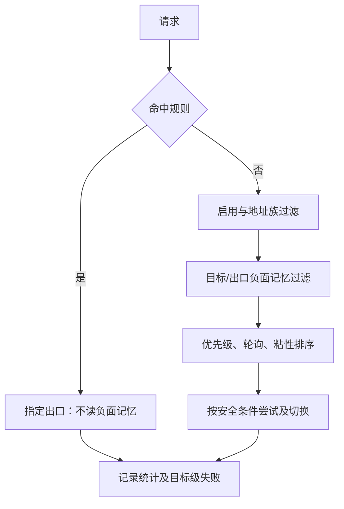

# 移除全局熔断（0.3.3）

| 版本号 | 日期 | 变更说明 | 作者 |
| :--- | :--- | :--- | :--- |
| v1.0.0 | 2026-11-04 | 根据用户确认移除全局熔断，保留负面记忆 | Agent |

## 背景、范围与取舍

用户确认仅保留目标级负面记忆，要求先文档后代码并升级补丁版本至0.3.3。全局熔断会因某出口连续失败而影响其它目标；现有热关闭还可能残留OPEN/HALF_OPEN状态。选择移除状态机与路由过滤，避免只关闭配置留下可重新启用的隐藏行为。保留旧配置、API和数据库列作兼容层，不做破坏性迁移；完全删除兼容字段会使旧配置无法启动，不采用。

## 生效契约

1. 候选出口只按启用状态、地址族能力、目标/出口负面记忆过滤，再按优先级、轮询与粘性排序。所有候选被历史负面记忆过滤时仍按原有规则放宽一次。
2. 不再有按出口全局OPEN/HALF_OPEN状态、冷却期或单并发探针准入，执行器也不再二次过滤出口健康状态。失败分类和安全重试条件、规则强制路由失败不切换均保留。
3. RouteMemory、route_block_ttl、隧道早夭判断和600秒默认负面记忆不变；一个目标失败不会通过全局健康状态影响其他目标。
4. HealthTable继续统计成功/失败、连续出口级失败、最后错误、认证错误和流量；direct失败仍不计出口级连续失败。统计本身不决定路由。
5. 旧routing.circuit_breaker表及PATCH字段继续解析和类型校验；enabled的有效值固定false，阈值与冷却仅为历史兼容数据，不能重新开启功能。健康响应circuit_state固定closed、available表示出口配置是否启用，不表示某个目标一定可达。旧reset端点保留鉴权和审计，仅清连续失败和认证标志，保留累计与流量；不清负面记忆。
6. SQLite沿用旧schema，circuit_state列仅保留closed；启动不恢复历史熔断状态，不清空数据库或计数。界面删除熔断列、重置按钮及设置表单，保留健康统计。
7. 本次升级仓库版本、包版本与Compose镜像标签至0.3.3。生产容器部署需单独执行构建和重建，版本文件修改本身不是部署证明。

## 风险与验收

坏出口可能被不同目标重复尝试，增加连接次数与超时；通过现有负面记忆、超时、连接上限和手动禁用出口管理。不得用新的全局退避替代已删除机制。连续大量UPSTREAM_ERROR后，其他目标仍可选用该出口；路由错误负面记忆只影响对应host；无半开单探针限制；旧配置enabled=true也不能生效；统计、存储回填、配置热重载、Web健康输出及负面记忆测试应通过。执行Ruff、MyPy与相关及完整测试。

## 实施顺序

文档修订 → 健康状态机移除 → 路由与执行器移除闸门 → 配置/API兼容与UI移除 → 测试更新 → 版本升级及检查。使用现有工作区实施，不创建新架构或新增依赖。

## Related

- [需求](../requirements/PRD_OVERVIEW.md)
- [路由设计](DD_ROUTING.md)
- [配置](DD_CONFIG.md)
- [Web](DD_WEB.md)
- [存储](DD_STORAGE.md)
