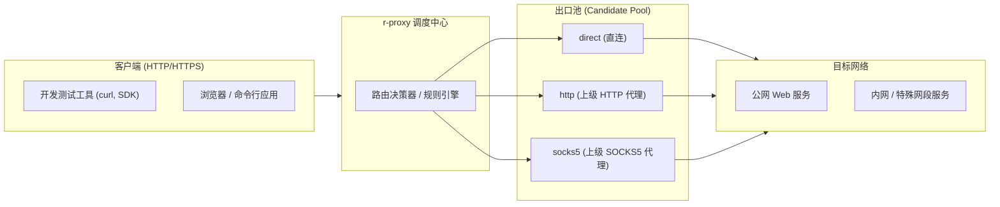
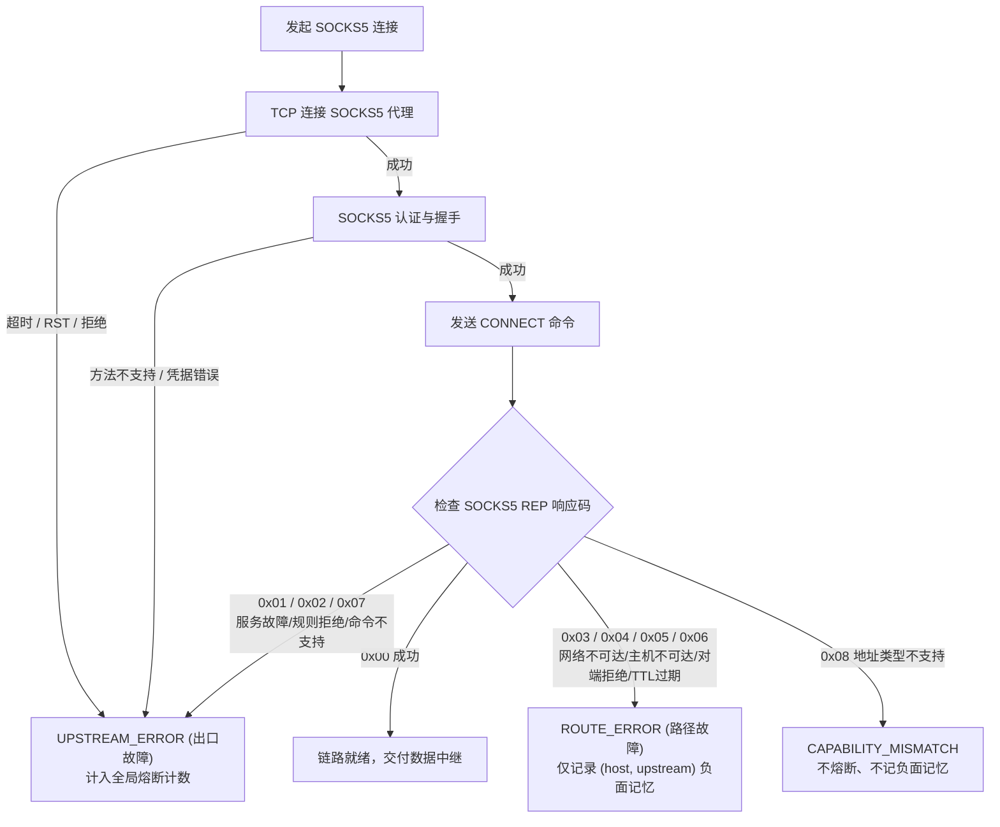

# SOCKS5_UPSTREAM.md - 上级 SOCKS5 代理需求规范

| 版本 | 日期 | 变更说明 | 作者 |
| :--- | :--- | :--- | :--- |
| v1.0.0 | 2026-10-12 | 初始版本：SOCKS5 上游支持需求定义、协议规范、路由与故障切换契约、WebUI 交互规范 | Agent |

## 1. 背景与愿景

r-proxy 当前支持两种出口类型：`direct`（直连目标）与 `http`（标准 HTTP 代理）。

在开发与测试、混合云部署以及复杂网络穿透场景中，大量既有的代理网络与工具链均以 **SOCKS5**（RFC 1928）协议对外暴露服务（例如 SSH 动态端口转发 `ssh -D`、企业级内网穿透网关、各类开发环境调试代理等）。

为了让 r-proxy 具备更强的流量中继与调度能力，系统需要支持将 SOCKS5 代理作为合法上游出口加入候选池与规则链。

### 1.1 核心设计准则

1. **零第三方运行时依赖（Zero Runtime Dependencies）**：
   - 依据 [`AGENTS.md`](../../AGENTS.md) 核心红线，代理核心运行环境严禁引入任何第三方 SOCKS 库（如 `PySocks`、`aiohttp-socks` 等）。
   - 必须基于 Python 3.12+ 标准库 `struct` 与 `asyncio` 原生实现轻量级 SOCKS5 客户端协议栈。
2. **端到端契约无缝兼容**：
   - SOCKS5 出口必须完全遵循现有的粘性会话（Sticky Sessions）、失败切换判据（Switching Policy）、熔断器（Circuit Breaker）以及负面记忆（Route Block）体系。
3. **保持应用层协议无损**：
   - 明确区分 L4（传输层 SOCKS5）与 L7（应用层 HTTP）代理的转发特征，确保普通 HTTP 请求行格式与双向 HTTPS 隧道透传的绝对正确。

---

## 2. 用户故事与核心使用场景

### 2.1 典型场景



- **场景 A（混合协议上游调度）**：
  用户在 `config.toml` 中同时配置 HTTP 代理、SOCKS5 代理以及 direct 直连。针对境外或特定专网目标，规则命中或自动轮询走 SOCKS5 出口，其余流量走 HTTP 代理或直连，失败时自动按优先级切换。
- **场景 B（SSH 隧道接入）**：
  开发人员通过 `ssh -D 1080 user@bastion` 建立了内网跳板通道，只需在 r-proxy 中配置一个 `type = "socks5"`、`address = "127.0.0.1:1080"` 的出口，即可让所有通过 r-proxy 的 HTTP/HTTPS 请求透明穿透到该跳板网络。
- **场景 C（带凭证的私有 SOCKS5 服务）**：
  企业 SOCKS5 网关启用了 RFC 1929 用户名/密码认证，r-proxy 能通过安全配置传递凭据并完成认证鉴权。
- **场景 D（远程 DNS 解析防污染）**：
  客户端请求域名目标时，r-proxy 通过 SOCKS5 的 Domain 寻址能力将域名交给远端代理服务器解析，防止本地 DNS 污染和劫持。

---

## 3. 功能性需求

### 3.1 配置模型扩展

在主配置文件 `config.toml` 与运行期配置对象中扩展 `upstreams`：

1. **`type` 枚举扩充**：
   - 字段合法值由 `["http", "direct"]` 扩展为 `["http", "socks5", "direct"]`。
2. **`address` 格式**：
   - 当 `type = "socks5"` 时为必填项。
   - 格式与 HTTP 代理完全一致：`host:port`。支持 IPv4 字面量、带方括号的 IPv6 字面量（如 `[2001:db8::1]:1080`）以及域名。
3. **`auth` 认证配置**：
   - 激活此前预留的 `[upstreams.auth]` 配置块。
   - 支持子字段 `username` (string) 与 `password` (string)。
   - 当 SOCKS5 代理需要认证时，若未配置凭证或认证失败，应产生明确的错误归类。

配置示例：

```toml
[[upstreams]]
name = "ssh-tunnel"
type = "socks5"
address = "127.0.0.1:1080"
priority = 20
enabled = true

[[upstreams]]
name = "corporate-socks5"
type = "socks5"
address = "proxy.corp.internal:1080"
priority = 30
connect_timeout = 5
read_timeout = 30
enabled = true

[upstreams.auth]
username = "proxy_user"
password = "secret_password"
```

### 3.2 协议交互与转发规范

#### 3.2.1 SOCKS5 握手流程 (RFC 1928 / RFC 1929)

1. **认证方法协商 (Method Selection)**：
   - 若未配置 `auth`：客户端在初始报文中声明仅支持 `0x00` (NO AUTHENTICATION REQUIRED)。
   - 若配置了 `auth`：客户端声明支持 `0x00` 与 `0x02` (USERNAME/PASSWORD)。
   - 若服务端返回 `0xFF` (NO ACCEPTABLE METHODS)，连接终止并归类为 `UPSTREAM_ERROR`。
2. **子协议认证 (Sub-negotiation)**：
   - 若协商选用 `0x02`，执行 RFC 1929 握手，发送用户名与密码。
   - 服务端响应状态为非 `0x00` 时，判定认证失败，归类为 `UPSTREAM_ERROR`。
3. **建立连接 (CONNECT Command)**：
   - 无论客户端发来的是普通 HTTP 请求还是 HTTPS CONNECT 请求，向 SOCKS5 代理发起的命令均为 `CMD = 0x01` (CONNECT)。
   - **目标寻址策略**：
     - 若目标为域名，必须优先使用 `ATYP = 0x03`（Domain Name，带 1 字节长度），将域名交由上级 SOCKS5 服务端执行远端解析。
     - 若目标为 IPv4 字面量，使用 `ATYP = 0x01`。
     - 若目标为 IPv6 字面量，使用 `ATYP = 0x04`。
   - 服务端返回响应报文，解析 `REP` 字段判定连接结果。

#### 3.2.2 请求行与协议报文格式差异

r-proxy 必须根据出口类型准确组装发往后端的 HTTP 请求报文：

| 请求类型 | 出口类型 | 请求行规范 (Request Line) | 头部处理 |
| :--- | :--- | :--- | :--- |
| **普通 HTTP** (GET/POST...) | `http` (HTTP代理) | **absolute-form**: `GET http://example.com/path HTTP/1.1` | 保留目标 Host，剔除 hop-by-hop 头 |
| **普通 HTTP** (GET/POST...) | `direct` (直连) | **origin-form**: `GET /path HTTP/1.1` | 注入 `Host: example.com`，剔除 hop-by-hop 头 |
| **普通 HTTP** (GET/POST...) | **`socks5`** | **origin-form**: `GET /path HTTP/1.1` | **与 `direct` 完全一致**（SOCKS5 打通的是端到端透明通道） |
| **HTTPS 隧道** (CONNECT) | `http` (HTTP代理) | 向上级发送文本 `CONNECT host:port HTTP/1.1` | 等待 `200` 响应后双向透传 |
| **HTTPS 隧道** (CONNECT) | `direct` (直连) | 直接 TCP 连接目标，回复客户端 `200 Connection Established` | 双向透传 |
| **HTTPS 隧道** (CONNECT) | **`socks5`** | 发起 SOCKS5 二进制握手并 CONNECT 目标，成功后回复客户端 `200 Connection Established` | 双向透传 |

> [!IMPORTANT]
> **红线警示**：SOCKS5 连接成功后，TCP 对端即为原始 Web 服务器。发往原始 Web 服务器的普通 HTTP 请求**严禁**使用 `http` 代理的 absolute-form 形式，否则将引起大量 Web 服务器直接返回 `400 Bad Request`。

### 3.3 故障归类与决策系统联动

必须精准映射 SOCKS5 连接各个阶段的异常状态至系统的两层错误治理体系：



具体状态码对应契约：

| 阶段 / SOCKS5 REP 响应 | 原始错误特征 | FailureKind 归类 | 状态机处理行为 |
| :--- | :--- | :--- | :--- |
| **代理自身连接阶段** | `TimeoutError`、`ECONNREFUSED`、`ENETUNREACH`（连代理服务器） | `UPSTREAM_ERROR` | 累加出口熔断失败计数，达阈值触发出口熔断 |
| **认证阶段** | 协商返回 `0xFF`、RFC 1929 返回状态非 0 | `UPSTREAM_ERROR` | 累加出口熔断失败计数 |
| **REP = 0x01** | General failure（SOCKS 服务端通用错误） | `UPSTREAM_ERROR` | 累加出口熔断失败计数 |
| **REP = 0x02** | Connection not allowed by ruleset | `UPSTREAM_ERROR` | 累加出口熔断失败计数 |
| **REP = 0x03** | Network unreachable（目标网络不可达） | `ROUTE_ERROR` | 仅记录 `(host, upstream)` 负面记忆，有效期内跳过此出口 |
| **REP = 0x04** | Host unreachable（目标主机不可达） | `ROUTE_ERROR` | 仅记录 `(host, upstream)` 负面记忆 |
| **REP = 0x05** | Connection refused（目标主机拒绝连接） | `ROUTE_ERROR` | 仅记录 `(host, upstream)` 负面记忆 |
| **REP = 0x06** | TTL expired | `ROUTE_ERROR` | 仅记录 `(host, upstream)` 负面记忆 |
| **REP = 0x07** | Command not supported | `UPSTREAM_ERROR` | 累加出口熔断失败计数 |
| **REP = 0x08** | Address type not supported | `CAPABILITY_MISMATCH` | 记录日志供审计，不计入负面记忆与熔断 |

### 3.4 Web 管理界面与探活 (WebUI & Probe)

1. **出口列表与表单**：
   - 出口管理页面的「类型」下拉菜单支持选定 `socks5`。
   - 选择 `socks5` 时，地址栏显示占位符 `host:port`。
   - 表单支持展开或填写 `username` 与 `password`。
2. **主动连通性探测 (Probe)**：
   - 允许管理员在 Web 界面针对 SOCKS5 出口触发「连通性测试」。
   - 复用统一的探测目标（`www.gstatic.com:443`），执行完整的 SOCKS5 握手并报告真实延迟、REP 状态码及错误详情。
   - 探测结果不污染运行期健康熔断状态（遵循安全隔离规范）。
3. **敏感凭据脱敏展示**：
   - Web 界面与配置导出接口中，SOCKS5 的认证密码必须显示为掩码或予以脱敏（`***`），严禁明文回显至前端。

---

## 4. 非功能性需求

1. **零第三方依赖与标准库兼容**：
   - 代码实现只依赖 Python 3.12+ 内置模块（`asyncio`, `struct`, `ipaddress`, `dataclasses`, `enum`）。
   - 保持核心代理模式（`--no-web`）在纯裸机与极简容器环境下的零额外依赖安装能力。
2. **高性能与流式吞吐**：
   - SOCKS5 二进制帧编解码应采用预编译 `struct.Struct` 或精确字节切片，单次连接握手的内存分配次数不超过 3 次。
   - 数据透传阶段无缝衔接现有 `StreamReader/StreamWriter` 中继机制，吞吐量衰减 < 1%。
3. **安全性与信息隐藏**：
   - 客户端侧返回的 502/504 错误响应体中**严禁泄露** SOCKS5 代理的内网地址、端口及凭证信息。
   - 审计日志记录配置变更时，对密码字段执行掩码处理。

---

## 5. 验收标准清单 (Acceptance Criteria)

- [ ] **AC-1（配置解析）**：`config.toml` 中定义 `type = "socks5"` 能够成功加载并通过配置合法性校验；非法端口或缺失地址时报 `E_ADDRESS_FORMAT`。
- [ ] **AC-2（无认证隧道建立）**：客户端向 r-proxy 发送 `CONNECT target:443`，经由无认证 SOCKS5 出口转发，能正确完成 SOCKS5 握手，客户端收到 `200 Connection Established` 且 TLS 流量正常双向透传。
- [ ] **AC-3（用户名/密码认证）**：SOCKS5 出口配置了用户名密码，能正确完成 RFC 1929 认证交互；凭据错误时触发 `UPSTREAM_ERROR`。
- [ ] **AC-4（HTTP 明文转发）**：客户端发送普通 `GET http://target/path`，经由 SOCKS5 出口转发，后端实际收到的是 `GET /path HTTP/1.1`，并且收到后端返回的 200 及完整响应体。
- [ ] **AC-5（故障归类与熔断）**：
  - SOCKS5 代理宕机或端口不通时，判定为 `UPSTREAM_ERROR`，熔断计数增加；
  - 目标主机在 SOCKS5 侧返回 `REP = 0x05` 时，判定为 `ROUTE_ERROR`，记录针对该 host 的负面记忆，出口本身不熔断。
- [ ] **AC-6（WebUI 探活）**：在 Web 界面对 SOCKS5 出口点击测试，能返回真实连接耗时与状态。

---

## 6. 相关文档

- [产品需求总览 (PRD_OVERVIEW.md)](./PRD_OVERVIEW.md)
- [路由规则说明 (RULES_CONFIG.md)](./RULES_CONFIG.md)
- [Web 管理界面规范 (WEBUI_SPEC.md)](./WEBUI_SPEC.md)
- [SOCKS5 详细设计文档 (DD_SOCKS5.md)](../design/DD_SOCKS5.md)
- [出口连接器设计 (DD_PROXY.md)](../design/DD_PROXY.md)
